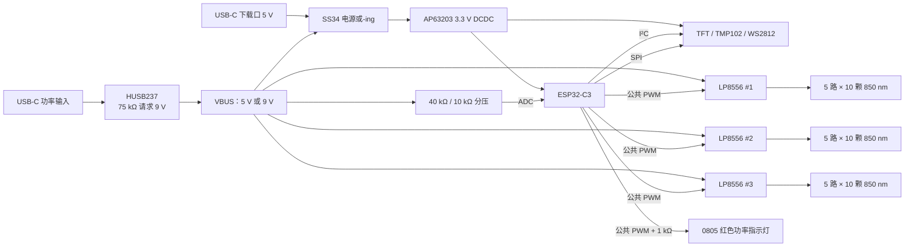
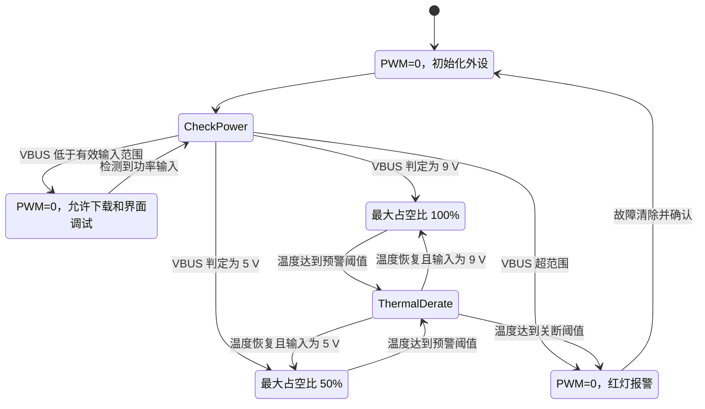

# 850 nm 红外 LED 控制验证板设计报告

> 文档版本：V1.1  
> 编制日期：2026-08-16  
> 项目状态：LED 功率指示支路及 PCB 布局已完成修订，待制板/焊接与样机验证  
> 设计用途：验证 150 颗 850 nm LED 芯片的恒流驱动、统一调光、供电兼容、温度保护及人机交互

> V1.1 修订说明：替换 LED 驱动原理图与 PCB 布局图；删除原 6P5050/LED6 指示支路；新增由公共 `LED_PWM` 经 1 kΩ限流电阻驱动的单颗 0805 红色 LED，并同步更新设计审查、验证计划、风险清单与结论。

## 1. 项目概述

本验证板用于驱动 50 颗三芯 850 nm 5050 灯珠，每颗封装内部包含 3 颗 850 nm 发光芯片，总计 150 颗红外 LED 芯片。系统不要求单灯寻址，而是通过 ESP32-C3 输出一组公共 PWM 信号，对全部红外 LED 的亮度进行同步调节。

LED 阵列被组织为 15 路恒流串，每路串联 10 颗 850 nm 芯片。三颗 LP8556SQ-E09 各提供 6 路恒流下拉通道，其中每颗芯片的 5 路用于红外 LED，共形成 15 路红外恒流通道；每颗驱动器剩余的 LED6 通道不使用并保持悬空。可见光功率指示改为一颗 0805 红色 LED，由公共 `LED_PWM` 经 1 kΩ限流电阻直接驱动。主控制器采用 ESP32-C3-WROOM-02-N4，并配有 0.96 英寸 8 引脚 SPI TFT、TMP102 温度传感器、WS2812-V6 状态灯、两个调节按键、原生 USB 下载接口和 UART 调试接口。

供电端采用 HUSB237 进行 USB-C 取电，VSET 接 75 kΩ，优先请求 9 V。若电源端不支持 9 V 协议，系统允许在 5 V 下运行，但固件需要限制最大 PWM 占空比。控制部分由 AP63203 将输入电压转换为 3.3 V。

### 1.1 设计目标

- 统一控制 150 颗 850 nm LED 芯片的亮度。
- 目标满量程串电流约为 40 mA。
- 优先支持 9 V/2 A 输入，并兼容 5 V/2 A 降额运行。
- 通过 TFT 显示输入电压、亮度、温度、供电模式和故障状态。
- 通过 WS2812-V6 显示系统状态。
- 通过一颗 0805 红色 LED 的亮度直观指示红外输出功率。
- 通过 TMP102 与 VBUS 分压采样实现过温、异常供电和功率限制。
- 支持 USB 原生下载、UART 调试和实体按键调节。

### 1.2 当前设计审查结论

整体架构可行：9 V 取电、三组独立升压恒流驱动、公共 PWM 调光、3.3 V 控制电源、温度检测及显示交互之间的功能边界清晰。LP8556SQ-E09 的 6 通道结构与“每颗驱动 5 路红外串”的拓扑匹配良好。

V1.0 审查中发现的 6P5050/LED6 驱动问题已在 V1.1 原理图中消除：原 6P5050器件及其与三个 LED6恒流下拉端的连接已删除，三个未使用的 LED6通道保持悬空；新的 LED52 为单颗 0805红色 LED，通过 `LED_PWM → 1 kΩ → LED52 → GND`连接。该方案不占用额外 GPIO，功耗低，亮度与红外输出 PWM占空比同步，并且不会干扰 LP8556 的自适应升压控制。当前未发现与该指示支路相关的上电阻断项。

## 2. 系统架构



系统划分为以下功能区域：

1. 功率输入与协议诱骗部分：HUSB237、功率 USB-C 接口及 VSET 配置。
2. 控制电源部分：SS34 电源隔离/选择与 AP63203 3.3 V 同步降压。
3. 主控与通信部分：ESP32-C3、USB Serial/JTAG、UART、I²C、SPI 和按键。
4. LED 驱动部分：三颗 LP8556SQ-E09 及其电感、肖特基二极管和滤波电容。
5. 红外发光阵列：50 颗三芯封装，共 150 颗 850 nm LED 芯片。
6. 安全检测部分：VBUS ADC、TMP102、软件限功率和过温关断。
7. 指示与显示部分：TFT、WS2812-V6 和 0805 红色功率指示灯。

## 3. 原理图设计说明

### 3.1 主控、电源与安全检测原理图


*图 1　HUSB237、AP63203、ESP32-C3、TMP102、TFT、USB/UART、按键与状态灯电路。*

### 3.2 LED 驱动与红外阵列原理图


*图 2　三颗 LP8556SQ-E09、15 路红外 LED 串及由公共 PWM驱动的 0805 红色功率指示灯。*

## 4. 输入电源与 3.3 V 电源设计

### 4.1 HUSB237 取电

HUSB237 作为 USB PD/QC 取电端控制器，VSET 通过 75 kΩ接地，用于请求 9 V。板上功率 USB-C 端口主要负责供电，不承担 ESP32-C3 原生 USB 下载。其工作策略如下：

- 支持 9 V 的 PD/QC 电源：VBUS 升至约 9 V，允许较高输出功率。
- 不支持快充的 USB-C 或 USB-A 转 USB-C 电源：保持约 5 V，固件进入降额模式。
- USB-A 转 USB-C 线本身不会自动产生 9 V；只有 USB-A 口、电源线缆和 HUSB237 共同支持相应快充协议时才可能获得 9 V，否则按 5 V 处理。

HUSB237 官方资料说明该器件支持 5/9/12/15/20 V 档位、PD3.1、BC1.2 及 QC2.0。本板固定为 75 kΩ配置，固件仍必须通过 ADC 实测 VBUS，不能仅根据“已插入快充电源”推断电压。

### 4.2 双电源隔离与下载供电

原理图使用两颗 SS34，将功率输入 VBUS 与 USB 下载口 5 V 隔离后汇合为控制电源输入 VCC。该结构允许：

- 仅连接下载 USB 时，ESP32-C3、TFT 和传感器能够上电并烧录程序。
- 连接 9 V 功率输入时，由功率端为整个控制系统供电。
- 两个接口同时连接时，肖特基二极管降低互相回灌风险。

验证时仍应测量两个接口同时连接情况下的二极管方向、压降和反向漏电，确保电脑 USB 端不出现异常回灌。

### 4.3 AP63203 3.3 V 同步降压

AP63203 为 3.8～32 V 输入、2 A 级同步降压芯片。本设计采用 3.9 µH 电感、10 µF 输入电容、两颗 22 µF 输出电容及自举电容，输出固定 3.3 V，为 ESP32-C3、TFT、TMP102、WS2812-V6 和 LP8556 的 EN/VDDIO 提供电源。

LP8556 的升压功率级和 VDD 从 VBUS 取电，并不由 AP63203 承担红外 LED 功率，因此 AP63203 的 2 A 额定值主要用于控制系统。上电验证应关注 AP63203 的 SW 波形、3.3 V 纹波、负载突变以及 Wi-Fi 发射时的电压跌落。

## 5. LED 阵列与 LP8556 驱动设计

### 5.1 红外 LED 拓扑

本板采用 15 路并联恒流串，每路串联 10 颗 850 nm LED 芯片：

- 串数：15 路；
- 每串 LED：10 颗；
- 总 LED 芯片数：15 × 10 = 150 颗；
- 物理封装数：50 颗，每颗含 3 颗芯片；
- 每颗 LP8556：负责 5 路红外恒流串；
- 三颗 LP8556：合计 15 路红外恒流串。
- 每颗 LP8556 的第 6 路恒流端：不使用并保持悬空。

串联结构使同一通道内电流天然一致，15 个恒流下拉通道则补偿不同灯串之间的正向压降差异。三颗驱动分别产生 VOUT1、VOUT2 和 VOUT3，减少单颗驱动的功率与热负担。

### 5.2 LP8556SQ-E09 配置

LP8556SQ-E09 为 WQFN 封装、6 通道、PWM-only 预配置版本。其单通道硬件能力最高可到 50 mA，但 E09 的默认 CURRENT_MAX 为 23 mA；本设计通过外部 ISET 电阻进行比例放大。

原理图中每颗驱动采用：

- `RISET = 14 kΩ`；
- `RFSET = 14.7 kΩ`；
- 升压电感 `10 µH`；
- 肖特基二极管 `SS34`；
- VBOOST 输出电容 `2 × 4.7 µF`；
- VLDO 电容 `10 µF`；
- VDD 去耦 `4.7 µF + 100 nF`。

根据 LP8556 数据手册的 ISET 公式，在 E09 的 CURRENT_MAX=23 mA、CURRENT=FFF 条件下：

```text
ILED ≈ 23 mA × 24 kΩ / 14 kΩ ≈ 39.4 mA
```

因此该电阻配置与约 40 mA 的目标基本一致。RFSET=14.7 kΩ对应约 1.25 MHz 升压开关频率和约 9.6 kHz 内部 PWM 频率配置。实际电流必须在样机上逐通道测量，并确认电感饱和电流、肖特基二极管温升和 LP8556 裸露焊盘散热。

### 5.3 公共 PWM 调光

ESP32-C3 的 GPIO1 通过 LEDC 外设产生公共 `LED_PWM`，同时送入三颗 LP8556。原理图中的 47 Ω串联电阻用于抑制边沿振铃，10 kΩ下拉电阻确保 ESP32-C3 复位或高阻期间 LED 默认关闭。

同一 `LED_PWM` 网络还经 R23（1 kΩ）连接至单颗 0805 红色 LED，LED 阴极接地。按红色 LED 正向压降约 1.8～2.4 V估算，PWM 高电平时 GPIO 负载电流约为：

```text
ILED52 ≈ (3.3 V − VF) / 1 kΩ ≈ 0.9～1.5 mA
```

该电流远低于 ESP32-C3 GPIO 的常用驱动能力，对三颗 LP8556 的 PWM 输入影响很小；LED52 的平均电流和可见亮度随公共 PWM 占空比变化。由于器件型号尚未给出，首板应以实测亮度和实际 VF为准，必要时再将 R23 调整为 680 Ω～2.2 kΩ。

推荐固件初始配置：

- 外部 PWM 频率：1～5 kHz；
- 上电初始占空比：0%；
- 软启动时间：300～500 ms；
- 9 V 模式最大占空比：100%；
- 5 V 模式最大占空比：50%；
- 过温或异常电压时：立即降为 0%。

5 V 下限制占空比只能降低平均功率，不能降低 PWM 导通瞬间的串电流。输入电容、升压电感和电源线仍需承受约 40 mA/串的脉冲满载状态。

### 5.4 I²C 使用边界

三颗 LP8556 的固定 7 位地址均为 `0x2C`，无法通过同一 I²C 总线分别寻址。由于本项目选择 E09 并按 PWM-only 方式运行，固件不应依赖 LP8556 的独立寄存器读写。若保留 SDA/SCL 连接：

- 可将三颗器件视为同地址、同配置的写入广播组；
- 禁止读取 LP8556 状态寄存器，因为多个器件会同时驱动 SDA，返回结果不具备可解释性；
- TMP102 地址与 `0x2C` 不冲突，可正常独立访问；
- 若未来需要逐颗诊断，应增加 I²C 多路复用器或改用可配置地址的驱动器。

## 6. 功率估算与供电模式

按每颗 850 nm 芯片在 39.4 mA 时正向压降约 1.3～1.6 V 估算：

```text
单串功率 ≈ 10 × Vf × 39.4 mA = 0.51～0.63 W
15 路 LED 总功率 ≈ 7.7～9.5 W
```

考虑三组升压转换损耗和控制系统功耗，建议按约 10～12 W 的整板峰值输入能力预留。

| 输入模式 | 预估工作状态 | 建议最大占空比 | 预估平均输入电流 | 结论 |
|---|---|---:|---:|---|
| 9 V/2 A | 全功率 | 100% | 约 1.1～1.4 A | 推荐工作模式 |
| 5 V/2 A | 降额 | 50% | 约 0.9～1.2 A | 可用，需软件限功率 |
| 5 V/2 A | 全功率 | 100% | 可能接近或超过 2 A | 不建议 |

以上为工程估算，不替代实测。最终应记录 VBUS 电压、电源端电流、三路 VOUT、电感峰值电流和各器件温升。

## 7. ESP32-C3 控制与接口分配

| GPIO | 功能 | 软件外设/说明 |
|---:|---|---|
| GPIO0 | VBUS 电压采样 | ADC1_CH0 |
| GPIO1 | 三颗 LP8556 公共调光 | LEDC PWM |
| GPIO2 | KEY_UP | 低有效；启动绑带脚，外部上拉 |
| GPIO3 | TFT DC/RS | 普通 GPIO 输出 |
| GPIO4 | I²C SDA | TMP102 及预留 LP8556 总线 |
| GPIO5 | I²C SCL | 最高建议 400 kHz |
| GPIO6 | TFT SCLK | SPI2 原生时钟 |
| GPIO7 | TFT MOSI | SPI2 原生数据输出 |
| GPIO8 | WS2812 DIN | RMT/SPI；启动绑带脚，外部上拉 |
| GPIO9 | KEY_DOWN/BOOT | 低有效；按住复位进入下载模式 |
| GPIO10 | TFT CS | SPI2 CS0 |
| GPIO18 | USB D− | USB Serial/JTAG |
| GPIO19 | USB D+ | USB Serial/JTAG |
| GPIO20 | UART RXD | 调试接口/测试点 |
| GPIO21 | UART TXD | 调试接口/测试点 |

GPIO2、GPIO8 和 GPIO9 是启动绑带脚。GPIO2/8/9 应保持正确上拉，按键接地；GPIO9 不应并联较大电容。WS2812 使用 3.3 V供电，数据电平与 ESP32-C3 一致。

## 8. 检测、显示与软件控制逻辑

### 8.1 VBUS 检测

原理图采用 40 kΩ/10 kΩ分压，比例为 1:5，并以 4.7 µF 电容滤波：

```text
VADC = VBUS × 10 kΩ / (40 kΩ + 10 kΩ) = 0.2 × VBUS
```

典型采样值：

- 5 V 输入：约 1.0 V；
- 9 V 输入：约 1.8 V。

建议固件先进行多次平均并使用 ADC 校准，再以约 1.4 V 为 5 V/9 V 分界，同时设置迟滞，避免插拔或协商瞬间反复切换模式。若采样值超出预期范围，应先关闭 LED_PWM，再显示供电故障。

### 8.2 TMP102 温度检测

TMP102 使用 3.3 V供电，SDA/SCL 各由 4.7 kΩ上拉，ADD0 接地时典型地址为 `0x48`。ALERT 在本设计中可不连接，由 ESP32-C3 定时轮询温度。

建议初始保护参数如下，最终应根据实测温度梯度重新标定：

- 小于 55 ℃：正常运行；
- 55～65 ℃：显示预警，可开始线性降额；
- 65～70 ℃：强制降低最大 PWM；
- 达到 70 ℃：关闭 LED_PWM；
- 温度回落至 55 ℃以下后，等待数秒并人工确认或软启动恢复。

TMP102 测得的是 PCB 局部温度，不等于 LED 结温或 LP8556 芯片结温。因此验证时还应使用热电偶或热像仪测量 LED、LP8556、电感、SS34 和 AP63203。

### 8.3 TFT、按键与状态灯

TFT 使用四线 SPI：GPIO6 为 SCLK、GPIO7 为 MOSI、GPIO10 为 CS、GPIO3 为 DC。屏幕 RESET 可与系统复位网络联动，背光由 3.3 V经限流电阻供电。软件必须根据实际屏幕控制器型号配置驱动、分辨率及偏移量。

两颗按键建议采用短按调节、长按加速，并进行 20～50 ms 去抖。GPIO9 兼作 BOOT：运行时可以作为 KEY_DOWN，但用户在复位时按住会进入下载模式。

当只连接 USB 下载口、功率输入口未连接时，ESP32-C3 仍可由下载口供电，但 VBUS 采样接近 0 V。固件应将其识别为“USB维护模式”，保持 LED_PWM=0，而不是反复尝试启动红外驱动。

LED52 是功率随动指示灯，不承担故障编码：`LED_PWM=0` 时应熄灭，占空比升高时平均亮度应单调增加。WS2812-V6 继续负责工作模式和故障状态显示，因此两种指示功能互不替代。

WS2812-V6 建议状态定义：

| 颜色/效果 | 状态 |
|---|---|
| 蓝色常亮 | 初始化或 USB 下载供电 |
| 绿色常亮 | 9 V正常运行 |
| 黄色常亮 | 5 V降额运行 |
| 橙色呼吸 | 温度预警/主动降额 |
| 红色闪烁 | 过温、VBUS异常或驱动故障 |
| 熄灭 | 未上电或系统保持关闭 |

### 8.4 推荐固件状态机



## 9. PCB 分区与布局评估


*图 3　修订后的 PCB 整体视图。上部为控制与接口区域，左侧为三组 LED 驱动，主体为五列红外灯珠阵列；单颗 0805 红色功率指示灯 LED52 位于右上区域。*

PCB 已按功能划分为功率部分、控制部分、LED 驱动部分、安全检测部分和指示灯部分。可观察到以下设计特点：

- ESP32-C3位于上边缘，天线区域设置了禁布标识。
- 三组 LP8556 及其升压外围沿左侧布置，便于各自连接 LED 灯串。
- 50 颗三芯灯珠以五列规则排列，有利于均匀发光和热扩散。
- 大面积铜皮与分布式过孔用于地回流和热扩散。
- 控制区与大面积 LED 阵列物理分离，减少开关节点对 ADC、I²C 和射频部分的影响。
- LED52及 R23已独立布置在控制区右上侧，不再连接三颗 LP8556的 LED6恒流端。

制板前或首板检查时应特别确认：

1. ESP32-C3天线正下方及前方所有层均无铜、走线和过孔；若模块天线未伸出基板边缘，应严格满足乐鑫净空要求。
2. LP8556 的 SW—二极管—输出电容高 di/dt 回路足够短，SW 铜皮不过大且远离 I²C、ADC 与天线。
3. 每颗 LP8556 裸露焊盘可靠接地，并通过多颗热过孔连接地平面。
4. 10 µH 电感的饱和电流和温升满足5 V低输入时的峰值电流。
5. VOUT1/2/3输出电容具有足够耐压，并考虑 MLCC 在直流偏压下的容量衰减。
6. 850 nm 阵列长走线不存在跨分割地、细颈或意外串错通道。
7. TMP102远离电感、AP63203和 LP8556热源，同时能代表 LED 区域温度；如只能二者选一，应明确其测温代表性。
8. USB D+/D−保持成对走线并尽量等长；接口附近应评估低电容 ESD 防护。
9. LED52 的极性、R23 的 1 kΩ阻值及其到 `LED_PWM`/GND 的连接应与新版网表一致，避免 PCB 保留旧的 LED6 网络。

## 10. 0805 红色功率指示支路

### 10.1 电路结构

新版原理图采用以下连接：

```text
ESP32-C3 GPIO1 / LED_PWM → R23 1 kΩ → LED52（0805 红色）→ GND
```

该支路使用低端接地的常规 GPIO 驱动方式，不再占用 LP8556 恒流通道。三颗 LP8556 的 LED6 端均保持未连接，符合未使用电流下拉通道悬空的应用方式。

### 10.2 电气核算与控制特性

按 GPIO 高电平 3.3 V、红色 LED 的 VF约 1.8～2.4 V计算，瞬时电流约 0.9～1.5 mA，R23 功耗约 0.8～2.3 mW，普通 0805 电阻具有充分余量。此电流主要用于近距离状态观察，不追求高亮度。

LED52 与三颗 LP8556 共用 `LED_PWM`，因而无需新增 GPIO、MOSFET或分流电阻。其亮度表示 PWM 指令占空比，而不是红外光功率的精密测量值；红外 LED 正向压降、驱动效率、供电模式和温度变化仍可能使实际光功率与可见指示亮度存在偏差。

上电时应确认 LED52 极性正确、0% 占空比完全熄灭、亮度随占空比单调变化，并检查 LED52 接入后 `LED_PWM` 高电平仍接近 3.3 V且边沿无明显畸变。

## 11. 样机验证计划

### 11.1 上电前检查

- 核对 HUSB237、AP63203、LP8556、SS34、LED 和电解/有极性器件方向。
- 核对 50 颗三芯 LED 的封装引脚与原理图符号映射。
- 核对 LED52 阳极经 R23 接 `LED_PWM`、阴极接 GND，R23 阻值为 1 kΩ。
- 确认三颗 LP8556 的 LED6 端未连接，PCB 上不存在旧版 LED52/LED6 网络残留。
- 测量 VBUS、VCC、3.3 V、VOUT1/2/3对地阻值，排除短路。
- 核对 LP8556 裸露焊盘、散热过孔和地连接。
- 核对 GPIO2/8/9启动上拉和 GPIO1 PWM 下拉。
- 运行 ERC/DRC，并对照网表检查 PCB 更新是否完整。

### 11.2 分阶段上电

1. **控制电源测试**：使用限流5 V台式电源，仅验证 AP63203 输出3.3 V，不开启 LED_PWM。
2. **下载与主控测试**：验证 USB枚举、固件下载、UART日志、按键、TFT、WS2812、TMP102及 LED52随 PWM变化。
3. **VBUS识别测试**：分别输入5 V和9 V，记录 ADC原始值、校准电压及模式切换迟滞。
4. **单颗驱动测试**：仅焊接或启用一颗 LP8556，从1%～10%占空比逐步增加，测量 VOUT和五路串电流。
5. **三驱动低占空比测试**：全部驱动从5%开始，确认无异常啸叫、过流或 VBUS跌落。
6. **9 V功率爬升测试**：依次测试10%、25%、50%、75%和100%占空比，每档记录电压、电流和温度。
7. **5 V降额测试**：确认软件占空比不会超过50%，并测试插拔和电压跌落时是否自动关闭/重启软启动。
8. **热稳定测试**：在典型散热条件下持续运行30～60 min，记录热像和 TMP102温度曲线。
9. **故障测试**：模拟温度超限、ADC异常、单串开路、供电切换和主控复位，确认 PWM默认关闭。

### 11.3 建议测试点

| 测试点 | 测量内容 |
|---|---|
| VBUS | 协商后的5 V/9 V、电压跌落和纹波 |
| VCC | SS34隔离后的控制电源输入 |
| 3V3 | AP63203输出、纹波和瞬态 |
| VOUT1/2/3 | 三组升压输出及启动过冲 |
| LED_PWM | 频率、占空比、上电默认状态 |
| LED52阳极 | PWM高电平、电流及亮度随动特性 |
| ADC0 | VBUS分压后的实际电压 |
| SDA/SCL | TMP102通信和总线完整性 |
| USB D+/D− | 下载枚举与信号完整性 |
| UART TX/RX | 启动日志和故障记录 |
| 各 LED 串 | 实际恒流值及一致性 |

### 11.4 建议验收指标

| 项目 | 建议判据 |
|---|---|
| 3.3 V输出 | 3.20～3.40 V，Wi-Fi工作时不复位 |
| 9 V协商 | 稳定进入9 V档，无反复协商 |
| 5 V兼容 | 可启动、可显示、最大 PWM被限制到50% |
| 单路 LED电流 | 目标约39.4 mA，建议首板控制在±5%内 |
| 三路 VOUT | 高于对应 LED串总 Vf且低于 E09配置上限 |
| PWM=0 | 红外 LED可靠关闭，复位期间无明显闪光 |
| PWM线性 | 指令亮度单调变化，无大范围跳变或闪烁 |
| 0805功率指示灯 | PWM=0时熄灭，亮度随占空比单调变化，不影响 PWM高电平 |
| 温度保护 | 达阈值后能降额/关断，恢复过程无振荡 |
| USB下载 | 可稳定枚举、下载和输出日志 |
| TFT/按键/WS2812 | 长时间运行无花屏、误触发或状态错乱 |

## 12. 风险清单与改进建议

| 优先级 | 风险 | 影响 | 建议措施 |
|---|---|---|---|
| P1 | 三颗 LP8556固定同地址0x2C | 无法逐颗读取/诊断 | E09按 PWM-only使用，禁止并联读取；需要时加 I²C MUX |
| P1 | 5 V输入全功率余量不足 | 充电宝过流保护、掉电或反复重启 | 固件硬限制50%，保留迟滞和软启动 |
| P1 | 三颗驱动共用同步 PWM | 输入脉动和瞬态负载较大 | 加强 VBUS就近去耦，实测线缆压降和输入纹波 |
| P1 | ESP32-C3天线靠近大面积 PCB | Wi-Fi/BLE性能下降 | 确认全层禁铜和模块边缘布局要求 |
| P1 | 850 nm输出肉眼不可准确判断 | 误认为已关闭，存在眼睛暴露风险 | PWM硬件默认下拉、状态指示、遮光罩和警告标签 |
| P2 | VOUT MLCC直流偏压降容 | 输出纹波、升压不稳定 | 选足够耐压和有效容量，实测纹波 |
| P2 | USB-C端口 ESD防护未在图中明显体现 | 静电导致重启或器件损坏 | 评估低电容 ESD器件和接口布局 |
| P2 | TMP102只反映局部板温 | 不能直接代表 LED/驱动结温 | 热像/热电偶标定后再确定软件阈值 |
| P2 | ADC分压按5/9 V设计 | 错误请求更高档位时 ADC可能越界 | 固定 VSET、软件超限关断，必要时增加钳位 |
| P2 | LED52亮度仅跟随 PWM指令 | 不能精确表示实际红外光功率 | 将其定义为功率档位指示，实际输出用光功率计标定 |

## 13. 红外与热安全说明

850 nm 红外光仅有微弱可见红光或完全不可见，不能用肉眼亮度判断辐射强度。15 路、约40 mA的阵列具有较高总光功率，调试时应：

- 禁止近距离直视发光面；
- 使用摄像头、光功率计或探测卡确认输出状态；
- 在工作台上加遮光罩、固定朝向和明显警示；
- 固件启动、异常和复位期间保持 PWM为低；
- 最终产品根据使用距离、光学透镜、占空比和暴露时间进行光生物安全评估；
- 不在未完成安全评估前将验证板用于人体照射、医疗或健康用途。

## 14. 结论

本设计以 HUSB237、AP63203、ESP32-C3和三颗 LP8556SQ-E09构成完整的 850 nm 红外 LED控制验证平台。15 路、每路10颗的恒流串拓扑能够覆盖 50 颗三芯封装共150颗红外 LED，14 kΩ ISET电阻对应约39.4 mA目标串电流；公共 PWM可满足统一亮度控制，并可通过 VBUS检测在9 V与5 V供电下实施不同的最大功率策略。

控制、显示、温度检测、USB下载、UART调试和状态指示资源均可由 ESP32-C3实现，现有 IO分配完整。新版单颗 0805 红色 LED 直接由公共 PWM经 1 kΩ电阻驱动，其估算电流约为0.9～1.5 mA；三颗 LP8556 的 LED6通道保持悬空，已消除旧版可见光指示支路对恒流驱动的影响。PCB功能分区清晰，适合作为首版验证板。

首板上电前的关键动作是：核对 LED52极性及新版网表、完成5 V限流上电、单驱动低占空比测试、9 V逐级功率爬升、温升标定及红外安全措施。当前没有与功率指示支路相关的 P0 阻断项；完成上述验证后，才能确定该方案是否适合长时间满功率运行及后续产品化。

## 15. 参考资料

1. [HUSB237 产品与数据手册，慧能泰半导体](https://www.hynetek.com/2725.html)
2. [AP63203 产品资料，Diodes Incorporated](https://www.diodes.com/part/view/AP63203)
3. [LP8556 产品与数据手册，Texas Instruments](https://www.ti.com/product/LP8556)
4. [ESP32-C3-WROOM-02/02U 技术规格书，Espressif](https://documentation.espressif.com/esp32-c3-wroom-02_datasheet_cn.html)
5. LP8556 数据手册 `SNVS871M`（项目本地资料：`lp8556.pdf`）
6. JNJ-L-C5050CW-85010D-66010-85010D-SL-S2G1S2 灯珠规格书（项目本地资料）

## 16. 文档适用边界

本报告根据项目对话、器件数据手册、两页原理图截图和 PCB整体截图编制。由于未获得可机器检查的原理图工程、网表、BOM、PCB叠层、Gerber、铜厚和完整 DRC/ERC报告，文中的布局判断和网络审查不能替代 EDA工具的正式检查。任何与实际工程文件不一致之处，应以经过审查的源工程和器件最新数据手册为准。
